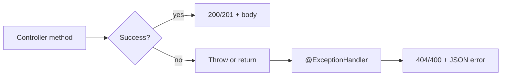

# Lecture 14 — REST + error handling: `ResponseEntity`, status codes, `@ExceptionHandler`, `@RestControllerAdvice`

**Date:** Sat 24 Oct 2026 · **Book:** *Object-Oriented Programming and Java*, 2nd ed. — **no new book chapter today** (Week 3 Sat = **REST + error handling** per `CURRICULUM.md`; ch.13–15 GUI/applets/servlets remain **skipped**).

**Time plan (1 h — lighter Sat, still full block):** 10 min recap (Fri Spring REST + skim **#4** progress) · 15 min read this lecture + [Spring Boot error handling](https://docs.spring.io/spring-boot/docs/current/reference/html/web.html#web.servlet.spring-mvc.error-handling) · 35 min hands-on (finish **#4** if needed, then curriculum **#5** + Week 3 **proof artifact**; problem statements in `CURRICULUM.md` only).

**Goal for today:** extend your in-memory todo API with **`GET /api/todos/{id}`**, return **404** with a **structured JSON error** when the id is missing, and **centralize** error responses with **`@ExceptionHandler`** and **`@RestControllerAdvice`** so **400** and **404** bodies match — then close Week 3 with the running app, **`curl` transcript**, and file-parsing exercise from the curriculum proof set.

> **Pacing note:** Week 3 in `CURRICULUM.md` schedules **Mon = ch.9 §9.1–9.5**, **Tue = §9.6 + try-with-resources**, **Wed = ch.10 streams & files**, **Thu = `java.nio.file` + `Scanner`**, **Fri = Spring Boot "hello REST"** (`lectures/2026-10-23-spring-boot-hello-rest.md`), **Sat = REST + error handling** (this file). Saturday is the **lighter morning** slot — review, polish, and proof — not a day off. Do not invent schedule changes inside this lecture.

---

## 1. Recap hook (Fri 23 Oct — use the first 10 minutes)

Without opening Fri’s lecture first, in `notes/`:

1. **Three bullets from yesterday:** e.g. what **`@RestController`** adds over **`@Controller`**; why **records** fit JSON DTOs; when **`ResponseEntity`** beats returning a bare record.
2. **One self-check from Lecture 13:** e.g. which status **POST /api/todos** should use on success; what curriculum **#4** requires for bad input (not an empty body).
3. **Skim** your **`exercises/week3-todo-api/`** (or Fri scratch) — note whether **GET list**, **POST create**, **201**, **200**, and **400 + JSON** already work. If **#4** is incomplete, **finish it first** in the hands-on slot, then **#5**.

Fri was **local** validation and **`ResponseEntity.badRequest()`** in the controller (or a helper). Sat is the same HTTP contract with **one read by id** and **one place** that maps “not found” and validation failures to consistent JSON — analogous to catching at a **boundary** in file **#1** instead of repeating the same report format on every line.

*(Book ch.13–15 remain **skipped**; see `CURRICULUM.md` [Book chapters skipped on purpose](#book-chapters-skipped-on-purpose).)*

---

## 2. Week 3 arc (what you are closing today)

| Day | Theme (curriculum) | Lecture file | Carry into Sat |
|---|---|---|---|
| **Mon 19** | ch.9 §9.1–9.5 exceptions | `lectures/2026-10-19-ch9-exceptions.md` | checked vs unchecked; catch vs propagate |
| **Tue 20** | §9.6 + try-with-resources | `lectures/2026-10-20-ch9-try-with-resources.md` | close resources; cleanup at boundaries |
| **Wed 21** | ch.10 streams & files | `lectures/2026-10-21-ch10-streams-files.md` | **#1** file parsing |
| **Thu 22** | `java.nio.file` + `Scanner` | `lectures/2026-10-22-nio-file-scanner.md` | **#1** / **#3** |
| **Fri 23** | Spring Boot hello REST | `lectures/2026-10-23-spring-boot-hello-rest.md` | **#4** GET/POST, **201** / **200** / **400** |
| **Sat 24** | REST + error handling | *this file* | **#5**, centralized errors, proof **`week3`** |

**Book read this week (your notes, not verbatim here):** Ch.9 Exception Handling (pp.119–134), Ch.10 I/O (pp.135–154; focus §10.1–10.4, 10.7–10.10 per curriculum).

**Modern thread:** Spring Boot **`@RestController`**, records as JSON, **`ResponseEntity`**, **`@ExceptionHandler`**, **`@RestControllerAdvice`** — per `CURRICULUM.md` Week 3 **Topics** and **Free resources**.

---

## 3. HTTP status codes — Week 3 proof set

Your **`notes/week3.md`** transcript should demonstrate these responses from **your** todo API (exact JSON field names are yours; keep them **consistent** across **400** and **404** after today):

| Code | Meaning | Curriculum use |
|---|---|---|
| **200 OK** | Success with a body | **GET /api/todos** (list, including empty list) |
| **201 Created** | Resource created | **POST /api/todos** success |
| **400 Bad Request** | Client sent unusable input | Bad create payload / validation (**#4**, refined today) |
| **404 Not Found** | No resource at that URI/id | **GET /api/todos/{id}** when id missing (**#5**) |

**Do not** rely on **500** for “id not found” — that is a **missing domain object**, not a server bug. Map it to **404** with a clear JSON message.

Other codes (**401**, **403**, **409**, **502**) appear in later weeks (gateway, auth, upstream LLM). Week 3 proof stops at **201**, **200**, **400**, **404**.

Official background: [Spring Guide — Building a RESTful Web Service](https://spring.io/guides/gs/rest-service/) (HTTP semantics); [Spring Boot reference — Web](https://docs.spring.io/spring-boot/docs/current/reference/html/web.html).

---

## 4. `ResponseEntity` recap — status + body + optional headers

From Fri: **`ResponseEntity`** expresses **status**, **headers**, and **body** in one return value.

| Pattern | Typical use |
|---|---|
| **`ResponseEntity.ok(body)`** | **200** + JSON list or single todo |
| **`ResponseEntity.status(HttpStatus.CREATED).body(created)`** | **201** after **POST** |
| **`ResponseEntity.badRequest().body(errorRecord)`** | **400** + JSON error (**#4**) |
| **`ResponseEntity.notFound().build()`** | **404** with **no** body — **avoid** for curriculum **#5** (structured error required) |
| **`ResponseEntity.status(HttpStatus.NOT_FOUND).body(errorRecord)`** | **404** + JSON error (**#5**) |

Prefer a **shared error record** (or small type) for **400** and **404** so clients parse one shape. Week 2 guide: error **payload** → **record**; mutable store → **class** / **service** bean.

Illustration only (you choose names and fields):

```java
return ResponseEntity.status(HttpStatus.NOT_FOUND).body(new ApiError("Todo not found: " + id));
```

---

## 5. JSON error bodies — one contract for clients

Curriculum **#4** and **#5** both require **JSON**, not plain text or HTML error pages.

Design choices **you** document in **`notes/`**:

| Concern | Options |
|---|---|
| **Shape** | e.g. `message` only; or `message` + `code` + optional `field` |
| **Consistency** | Same record for **400** validation and **404** missing id |
| **Jackson** | Records serialize cleanly; invalid JSON often fails before your handler — note that in the transcript |

| Layer | Thu / file **#1** | Sat / HTTP |
|---|---|---|
| Bad line | Report line number, continue | **400**, JSON explains validation failure |
| Missing resource | N/A (file path) | **404**, JSON explains missing **id** |
| Success | Sum / valid lines | **200** / **201** JSON bodies |

Spring Boot’s default **Whitelabel** / **`/error`** page is for browsers — for **`curl`** and API clients, **your** handlers should produce **application/json** error bodies on **400** and **404**.

Skim: [Spring Boot reference — Error handling](https://docs.spring.io/spring-boot/docs/current/reference/html/web.html#web.servlet.spring-mvc.error-handling).

---

## 6. `GET /api/todos/{id}` — path variables (curriculum **#5**)

**`@GetMapping("/{id}")`** (often on a class already prefixed with **`/api/todos`**) binds the path segment to a parameter:

```java
@GetMapping("/{id}")
public ResponseEntity<TodoResponse> getById(@PathVariable long id) {
    // lookup in same in-memory store as #4 — you implement
}
```

| Outcome | Status | Body |
|---|---|---|
| Id exists | **200** | Todo JSON |
| Id missing | **404** | Structured error JSON (**#5**) |

**Type of `id`:** match how you generate ids in **#4** (`long` vs `UUID` string). **`@PathVariable`** type conversion fails for non-numeric paths when you use **`long`** — decide whether that is **400** or **404** and note your rule in **`notes/`**.

Optional: **`Optional`** in the service layer vs throwing a **domain-specific exception** you map in advice (next sections) — both are valid; **#5** asks for **centralized** handling, not duplicated **`if (missing) return 404`** in every method if you can avoid it.

---

## 7. `@ExceptionHandler` — map exceptions to HTTP in one controller

**`@ExceptionHandler`** on a method (in the same **`@RestController`** or a separate advice class) runs when that controller (or advice scope) throws a matching exception.

Conceptual flow:



Illustration only — **you** define exception types and handler methods:

```java
@ExceptionHandler(TodoNotFoundException.class)
public ResponseEntity<ApiError> handleNotFound(TodoNotFoundException ex) {
    return ResponseEntity.status(HttpStatus.NOT_FOUND).body(new ApiError(ex.getMessage()));
}
```

Handlers return **`ResponseEntity`** (or **`@ResponseStatus`** + body type) so status and JSON stay aligned. One handler can cover several exception types via **`@ExceptionHandler({A.class, B.class})`** if you choose.

Baeldung (curriculum free resources): [Error Handling for REST with Spring](https://www.baeldung.com/exception-handling-for-rest-with-spring).

---

## 8. `@RestControllerAdvice` — centralized handlers for all REST controllers

**`@ControllerAdvice`** (with **`@ResponseBody`** on handler methods) applies to multiple controllers. **`@RestControllerAdvice`** = advice + REST semantics (JSON bodies on handlers).

| Approach | When |
|---|---|
| Handlers **inside** one **`@RestController`** | Tiny app; **#4**-only errors |
| **`@RestControllerAdvice`** class | **#5** + polish **#4** **400**s — **one** place for error JSON |

Typical structure **you** implement:

1. **`@RestControllerAdvice`** class in the same component-scan package as your app.
2. **`@ExceptionHandler`** methods for: not-found (**404**), validation (**400**), optionally a catch-all for unexpected errors (log + generic **500** — not required for Week 3 proof).
3. Controllers **throw** a small exception (or call a service that throws) when id is missing, instead of building **404** inline in three places.

Spring docs: same [Error handling](https://docs.spring.io/spring-boot/docs/current/reference/html/web.html#web.servlet.spring-mvc.error-handling) section — **`@ControllerAdvice`**, **`ProblemDetail`** (Spring 6+ RFC 7807 style) as optional reading; curriculum does **not** require Problem Details, only **structured JSON** you define.

**Contrast with ch.9:** a **checked** exception in file I/O vs an **unchecked** “not found” in a web layer is a design choice — justify briefly in **`notes/`** if you introduce a custom **`TodoNotFoundException`**.

---

## 9. Refactor path from Fri (**#4**) to Sat (**#5**)

| Fri (**#4**) | Sat (**#5** + advice) |
|---|---|
| **GET** list, **POST** create | **GET** **`/api/todos/{id}`** |
| **400** in controller OK | Move **400** mapping into advice if duplicated |
| In-memory store | Same store; lookup by id |
| Partial **`curl`** transcript | Complete **201**, **200**, **400**, **404** in **`notes/week3.md`** |

Keep **URLs and JSON shapes** stable where you can — Week 4 **#5** extends this API with **JPA** persistence.

Do **not** add a database today. Do **not** read book ch.15 servlets to “understand” advice — the Spring reference and guide are the path.

---

## 10. Testing with `curl` (complete `notes/week3.md`)

Adjust paths and bodies to match your app. Save **status line + body** for the proof artifact.

```bash
# 200 — list (may be empty)
curl -s -i http://localhost:8080/api/todos

# 201 — create
curl -s -i -X POST http://localhost:8080/api/todos \
  -H 'Content-Type: application/json' \
  -d '{"title":"Week 3 proof"}'

# 400 — bad input (example: blank title)
curl -s -i -X POST http://localhost:8080/api/todos \
  -H 'Content-Type: application/json' \
  -d '{"title":""}'

# 200 — get by id (use an id that exists from POST)
curl -s -i http://localhost:8080/api/todos/1

# 404 — missing id
curl -s -i http://localhost:8080/api/todos/99999
```

Redact nothing except secrets (there should be none in this app). Tag **`week3`** when the week proof is complete per curriculum.

---

## 11. Week 3 proof artifact (Sat checklist)

Per **`CURRICULUM.md` Week 3** **Proof artifact**:

| Item | Location |
|---|---|
| Running Spring Boot todo API | **`exercises/week3-todo-api/`** |
| **`curl` transcript** (**201**, **200**, **400**, **404**) | **`notes/week3.md`** |
| File-parsing exercise | curriculum **#1** (anywhere under **`exercises/`** you consolidated) |
| Git tag | **`week3`** |

If **#1–#3** are still open, note gaps in **`notes/`** — curriculum says **do not** double up missed weekdays on Sat; prioritize **#4**/**#5** and proof if time is tight.

Closing habit (2 min): one line in **`notes/`** — what clicked / what confused you about **`@RestControllerAdvice`** vs inline **`ResponseEntity`**.

---

## 12. Free resources (Week 3 Sat — links only)

Full Week 3 list lives in **`CURRICULUM.md`**; use these today:

- [Spring Guide — Building a RESTful Web Service](https://spring.io/guides/gs/rest-service/)
- [Spring Boot reference — Web](https://docs.spring.io/spring-boot/docs/current/reference/html/web.html)
- [Spring Boot reference — Error handling](https://docs.spring.io/spring-boot/docs/current/reference/html/web.html#web.servlet.spring-mvc.error-handling) (**primary skim today**)
- Baeldung: [Error Handling for REST with Spring](https://www.baeldung.com/exception-handling-for-rest-with-spring), [@ControllerAdvice](https://www.baeldung.com/global-error-handling-in-a-spring-rest-api)

---

## 13. Glossary

**HTTP 404 Not Found** · **HTTP 400 Bad Request** · **`@PathVariable`** · **`@ExceptionHandler`** · **`@ControllerAdvice`** · **`@RestControllerAdvice`** · centralized error mapping · **API error body** · **`ResponseEntity`** · **`HttpStatus`** · domain exception · component scan · **`curl -i`** · proof artifact · tag **`week3`**

---

## 14. Common pitfalls (Sat)

1. **404 with empty body** — curriculum **#5** requires **structured JSON**, not **`notFound().build()`** alone.
2. **500 for missing todo** — treat as **404** unless something truly broke (null store, etc.).
3. **Advice class outside component scan** — handlers never run; errors fall through to default HTML **`/error`**.
4. **Different JSON shapes for 400 vs 404** — clients harder to write; unify under one error record.
5. **Forgetting to finish **#4**** before **#5** — list/create must still pass transcript checks.
6. **Duplicate handler logic** — controller returns **404** *and* advice also maps the same case inconsistently.
7. **Jumping to JPA** — Week 4 **#5** extends persistence; finish in-memory proof first.
8. **Book ch.13–15** — no Swing/servlet detour; close Week 3 on Spring.

---

## 15. Self-check (answer in `notes/`, then check Spring docs)

1. When should **`GET /api/todos/{id}`** return **404** instead of **200** with null?
2. How does **`@RestControllerAdvice`** differ from putting **`@ExceptionHandler`** only on one controller?
3. Why does curriculum **#4** ask for a **JSON error body** on **400**?
4. What is the difference between Spring’s default **`/error`** page and **your** **`@ExceptionHandler`** response for API clients?
5. How does **centralized exception handling** relate to **try/catch at a boundary** in file exercise **#1**?
6. Which four status codes must appear in **`notes/week3.md`** for the Week 3 proof?

*Stuck for more than 15 min? Write the exact error/question in `notes/` and ask for a review — hints and feedback, not solutions.*

---

## 16. Hands-on (Sat — curriculum prompts only; you write all code)

Week 3 proof set: **five prompts** in **`CURRICULUM.md` Week 3** (**#1–#5**). Problem statements live in the curriculum only — **no solution code** in this lecture.

**Sat 24 Oct (REST + error handling):** finish **#4** if needed, then **#5**, then proof artifact.

### Curriculum **#4** (problem statement only — finish if incomplete)

Build a Spring Boot app with **`GET /api/todos`** and **`POST /api/todos`** storing items in memory; return correct HTTP status codes and a JSON error body for bad input.

### Curriculum **#5** (problem statement only — primary Sat add-on)

Add **`GET /api/todos/{id}`** that returns **404** with a structured error when missing, using centralized exception handling.

| Other prompts | Sat guidance |
|---|---|
| **#1** | Include in **`week3`** proof if not done; file-parsing exercise |
| **#2–#3** | Complete if time; do not skip **#5** / transcript for them |
| Proof | **`exercises/week3-todo-api/`**, **`notes/week3.md`**, tag **`week3`** |

---

## 17. Bridge to Week 4 (per `CURRICULUM.md`)

**Next week:** generics, collections internals, **Spring Data JPA** — Week 4 **#5** extends your todo API to **persist** with H2. Keep REST paths and JSON stable so you swap in-memory storage for a repository without breaking **`curl`** expectations.

Do not start ch.12 until Week 4 Mon per curriculum daily split.
