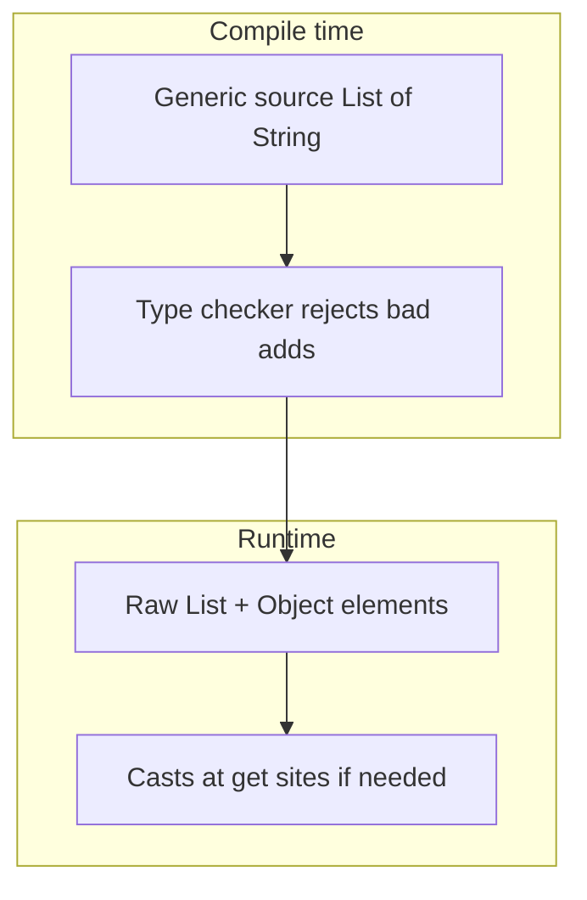

# Lecture 16 — Wildcards (PECS), bounded types, type erasure; ch.12 remainder

**Date:** Tue 27 Oct 2026 · **Book:** *Object-Oriented Programming and Java*, 2nd ed. — Ch.12 Generics and Collections Framework (pp.179–200; finish **§12.4–12.6** today after Mon’s **§12.1–12.3**; see `CURRICULUM.md` Week 4)

**Time plan (1 h):** 10 min recap (Mon + **#1** so far) · 20 min read this lecture + book §12.4–12.6 · 30 min hands-on (curriculum **#1** wildcard / **`Number`** sum part; problem statement in `CURRICULUM.md` only).

**Goal for today:** use **wildcard** types (**`?`**, **`? extends`**, **`? super`**) with **PECS** to write flexible APIs (especially “read from a list of numbers”), understand **type erasure** and what the JVM actually sees, and skim the **Collections Framework** interface map from ch.12 so **Wed**’s **ArrayList** / **HashMap** internals land on familiar vocabulary.

> **Pacing note:** Week 4 in `CURRICULUM.md` schedules **Mon = ch.12 §12.1–12.3**, **Tue = wildcards/erasure** (*this file*), **Wed = ArrayList & HashMap internals**, **Thu = sorting/searching, `equals`/`hashCode`, extra collections practice**, **Fri = JPA entity + repository**, **Sat = JPA queries + ch.17 JDBC skim + ch.16 serialization skim + review**. Do not invent schedule changes inside this lecture.

---

## 1. Recap hook (Mon — use the first 10 minutes)

Before §12.4, from memory in `notes/`:

1. **Three bullets from Lecture 15:** e.g. the **RTTI/casts** problem with raw collections; **`Pair<A,B>`** vs **`record`**; why **`max`** needs **`T extends Comparable<T>`**.
2. **One self-check from Mon:** e.g. difference between **type parameter** and **type argument**; why a **static** field cannot be type **`T`** in a generic class.
3. **Skim your **#1** scratch** (`exercises/2026-10-26-ch12-generics/` or similar): if **`Pair`** and **`max`** compile, focus today on the **sum-over-`Number` subtypes** method — that is where **wildcards** and **PECS** earn their keep.

Mon introduced **upper bounds on type parameters** (**`<T extends Number>`**). Tue shifts to **bounds on wildcard uses** (**`List<? extends Number>`**) and explains **why** your sum signature should be written one way and not another.

*(Book ch.13–15 — GUI, applets, servlets — remain **skipped**; see `CURRICULUM.md` [Book chapters skipped on purpose](#book-chapters-skipped-on-purpose).)*

---

## 2. Week 4 arc (where Tue sits)

| Day | Theme (curriculum) | Lecture file | Carry into Tue |
|---|---|---|---|
| **Mon 26** | generics ch.12 §12.1–12.3 | `2026-10-26-ch12-generics.md` | **`Pair`**, **`max`**, sum intuition |
| **Tue 27** | wildcards / erasure | *this file* | **PECS**, **`? extends` / `? super`**, erasure limits |
| **Wed 28** | ArrayList & HashMap internals | *(Wed lecture when published)* | growable array, buckets, resize |
| **Thu 29** | sorting, equals/hashCode, collections practice | *(Thu lecture when published)* | **`Comparable` vs `Comparator`** |
| **Fri 30** | JPA entity + repository | *(Fri lecture when published)* | Week 4 **#5** start |
| **Sat 31** | JPA queries + JDBC/serialization skim + review | *(Sat lecture when published)* | proof **`week4`** |

**Book read today:** Ch.12 **§12.4–12.6** (wildcards, erasure, Collections Framework overview). **§12.1–12.3** were Mon; together they complete ch.12 as scheduled in **`CURRICULUM.md` Week 4**.

**Modern thread:** same JDK **21** collections and OpenJDK source reads as Mon — **Wed** opens **`ArrayList.java`** and **`HashMap.java`** per curriculum **Free resources**.

---

## 3. Type parameters vs wildcards (§12.4 area)

Two different places bounds appear:

| You write… | Typical role | Example idea |
|---|---|---|
| **`<T extends X>`** on a **class or method** | **Define** a type variable used **inside** the API you implement | **`static <T extends Comparable<T>> T max(T a, T b)`** |
| **`? extends X` / `? super X`** on a **parameter** (often collections) | **Accept** types you do not own or must stay **flexible** at call sites | **`void printNumbers(List<? extends Number> nums)`** |

**Wildcard **`?`**** means “some type, unknown at this declaration site.” You **cannot** add arbitrary elements through **`? extends`** (compiler treats the list as a **producer** of **`X`**). You **cannot** read **`T`** out as a specific subtype through **`? super T`** in the same way you might write to it — it is a **consumer** of **`T`**.

**When to prefer which:** if **one consistent **`T`**** flows through several parameters and the return type, a **generic method** with **`<T extends …>`** is often clearer. If you only **read** from a **`List`** of numbers or **write** into a **`List`** of integers, **wildcards** on that **`List`** parameter avoid forcing callers to pick a single **`T`**.

Official: [Oracle Tutorial — Wildcards](https://docs.oracle.com/javase/tutorial/java/generics/wildcards.html), [Upper Bounded Wildcards](https://docs.oracle.com/javase/tutorial/java/generics/upperBound.html), [Lower Bounded Wildcards](https://docs.oracle.com/javase/tutorial/java/generics/lowerBound.html).

---

## 4. PECS — Producer Extends, Consumer Super (§12.4 continued)

**PECS** is a mnemonic for **wildcard direction**:

| Role of the parameterized type | Wildcard | Intuition |
|---|---|---|
| **Producer** — the structure **gives you** **`T`** (you **read** / **get**) | **`? extends T`** | “I can read **`T`** or subtypes; treat elements as **`T`**.” |
| **Consumer** — the structure **takes** **`T`** from you (you **write** / **add** / **set**) | **`? super T`** | “I can accept **`T`** and supertypes; safe to **`add`** **`T`**.” |

**Curriculum **#1** sum method:** you **read** each element and treat it as a **`Number`** (via **`doubleValue()`** or similar). The argument is a **producer of numbers** → **`List<? extends Number>`** (or **`Iterable<? extends Number>`**) is the usual shape. You are **not** trying to **`add`** new **`Double`**s into the caller’s **`List<Integer>`** — so **`? super`** is the wrong tool for that parameter.

**Contrast — copying into a destination list:** APIs like **`Collections.copy(dest, src)`** use **consumer super** on **`dest`** and **producer extends** on **`src`** — read the JDK signature in the API docs as a real-world PECS example (no need to reimplement today).

**Common mistake:** **`List<? extends Number>`** is **not** the same as **`List<Number>`**. You cannot **`add(3.14)`** to either in a type-safe way; the first accepts **`List<Integer>`**, **`List<Double>`**, etc. at the call site; the second is a list whose **declared** element type is exactly **`Number`**.

---

## 5. Bounded wildcards in practice (§12.4–12.5 area)

| Pattern | Safe operations (typical) | Call-site flexibility |
|---|---|---|
| **`Collection<? extends Number>`** | Iterate; read as **`Number`** | **`List<Integer>`**, **`List<Double>`**, … |
| **`Collection<? super Integer>`** | **`add(Integer)`** | **`List<Integer>`**, **`List<Number>`**, **`List<Object>`** |
| **`List<?>`** (unbounded wildcard) | **`get`** as **`Object`**; almost no **`add`** | Any parameterized **`List`** |

**Multiple bounds on wildcards** (book/advanced): **`? extends A & B`** — rare in your week-4 code; know it exists for library types.

**Relationship to Mon’s **`T extends Number`:** inside **your** generic method you might write **`<T extends Number>`** and take **`List<T>`** — that ties input list element type to **`T`**. For a **sum** that accepts **`List<Integer>`** today and **`List<Double>`** tomorrow without a single **`T`**, **`? extends Number`** on the parameter is the idiomatic **wildcard** spelling. **Tue hands-on:** pick one approach, make it compile, and **justify in `notes/`** using **PECS** (curriculum **#1** explicitly asks for this explanation).

---

## 6. Type erasure (§12.5 area)

Generics are a **compile-time** feature. After type-checking, the compiler **erases** most type parameters:

| Source (what you write) | Erasure (bytecode view) |
|---|---|
| **`List<String>`** | **`List`** with elements treated as **`Object`** (or **`String`** at call sites via casts the compiler inserts) |
| **`<T extends Number>`** | **`Number`** as the bound replaces **`T`** where needed |
| **Generic method **`<T> T foo(T x)`**** | **`Object foo(Object x)`** (with casts at return) |

**Consequences you should remember:**

1. **`if (obj instanceof List<String>)`** — **illegal** (cannot test type args at runtime).
2. **`new T()`**, **`new T[]`**, **`T.class`** — **not allowed** (no **`T`** at runtime).
3. **Overload resolution** cannot distinguish **`List<String>`** vs **`List<Integer>`** at runtime — they share one raw **`List`** class after erasure (bridge methods handle interface compatibility).
4. **`ClassCastException`** can still happen **inside** generic library code if you mixed raw and generic APIs or used unchecked casts.

**Why erasure exists (one sentence):** Java 5 generics were designed to keep **binary compatibility** with existing bytecode and libraries from the raw-type era — so the JVM did not get a second “reified” generic runtime.

**Reified generics elsewhere:** contrast mentally with languages that keep type args at runtime; in Java, **type safety is enforced by the compiler**, not by the JVM tagging every **`List`** with **`String`**.

**Link to Wed:** **`ArrayList`** in source code is written with generics for **you**; at runtime its **`elementData`** is still an **`Object[]`** — erasure is why internal arrays use **`Object`** and casts happen on **`get`**.

dev.java: [Type Erasure](https://dev.java/learn/generics/type-erasure/) (or Oracle tutorial *Erasure* section).

---

## 7. Collections Framework — ch.12 remainder (§12.6 area)

Finish ch.12 by mapping **interfaces** (not every implementation yet — **Wed** goes inside **`ArrayList`** / **`HashMap`**):

| Interface | Role | Type params | Tue takeaway |
|---|---|---|---|
| **`Collection<E>`** | root of lists/sets | **`E`** | **`add`**, **`remove`**, **`size`**, iteration |
| **`List<E>`** | ordered, indexed | **`E`** | **`get(i)`**, **`add(i, e)`** — **`ArrayList`** Wed |
| **`Set<E>`** | no duplicates | **`E`** | **`HashSet`** uses **`equals`/`hashCode`** (Thu) |
| **`Queue<E>`** / **`Deque<E>`** | FIFO/LIFO patterns | **`E`** | **`ArrayDeque`** mentioned in curriculum **Topics** |
| **`Map<K,V>`** | keys to values | **`K`**, **`V`** | **`HashMap`** Wed; not a **`Collection`** of entries in the same hierarchy |

**Legacy vs modern:** prefer **`List.of`**, **`Map.of`**, **`Set.copyOf`** for immutable snapshots (Week 4 **Topics**). Mutable **`ArrayList`** / **`HashMap`** remain the workhorses for **#2–#4**.

**Algorithm helpers:** **`Collections.sort`**, **`binarySearch`**, **`unmodifiableList`** — generic methods on raw **`Collection`** types; Thu connects **`Comparable`/`Comparator`**.

Do **not** read **ch.13–15** for UI collections; this framework is the data layer for JVM code and **Spring Data** repositories.

---

## 8. Design ties to your stack

| Layer | Tue concepts show up as… |
|---|---|
| **#1 sum API** | **`? extends Number`**, PECS note in **`notes/`** |
| **#2–#3 Wed–Thu** | **`List<T>`**, **`Map<K,V>`** with correct **`equals`/`hashCode`** |
| **Streams (Thu practice)** | **`Stream<T>`** is generic; wildcards less common than on **`List`** |
| **JPA **#5**** | **`JpaRepository<Entity, Id>`** — fixed type params, not wildcards, but same compile-time discipline |

Erasure explains why some Spring/JPA errors appear as **`ClassCastException`** or **`LinkedHashMap` cannot be cast to MyDto`** when JSON mapping and generics are misaligned — a preview for later weeks, not today’s exercise.

---

## 9. Free resources (Week 4 Tue — links only)

Full Week 4 list lives in **`CURRICULUM.md`**; use these today:

- [Oracle Tutorial — Wildcards](https://docs.oracle.com/javase/tutorial/java/generics/wildcards.html)
- [Oracle Tutorial — Type Erasure](https://docs.oracle.com/javase/tutorial/java/generics/erasure.html)
- [Oracle Tutorial — Collections](https://docs.oracle.com/javase/tutorial/collections/)
- [dev.java — Generics](https://dev.java/learn/generics/)
- Baeldung: [Java Generics](https://www.baeldung.com/java-generics), [Guide to Java Collections](https://www.baeldung.com/java-collections)

**Wed (preview):** OpenJDK [`ArrayList.java`](https://github.com/openjdk/jdk/blob/master/src/java.base/share/classes/java/util/ArrayList.java), [`HashMap.java`](https://github.com/openjdk/jdk/blob/master/src/java.base/share/classes/java/util/HashMap.java).

---

## 10. Glossary

**wildcard (`?`)** · **`? extends T`** (upper bounded wildcard) · **`? super T`** (lower bounded wildcard) · **PECS** · **producer / consumer** · **type erasure** · **reification** (contrast) · **bridge method** · **raw type** · **`Collection` / `List` / `Set` / `Map`** · **immutable factory methods (`List.of`)**

---

## 11. Common pitfalls (Tue)

1. **Using `List<Number>` where `List<? extends Number>` was needed** — rejects **`List<Integer>`** at call site.
2. **Adding to `? extends`** — compiler error; that list is a **producer**, not a **consumer**.
3. **Reading specific subtype from `? super T`** without a known **`T`** — you often only know **`Object`** or the lower bound.
4. **Assuming generics survive reflection** — **`ParameterizedType`** can recover *some* info; everyday code should not rely on it in **#1**.
5. **Raw `List` to “fix” wildcard annoyance** — reintroduces Mon’s cast bugs.
6. **PECS backwards** — “sum a list” = **extends** on the **source**; “fill a list” = **super** on the **sink**.
7. **Skipping **#1** note** — curriculum requires **why** you chose the wildcard; Tue is the day to write it.
8. **Book detour ch.13–15** — stay on collections + JPA path per **`CURRICULUM.md`**.

---

## 12. Self-check (answer in `notes/`, then check book §12.4–12.6)

1. In one sentence each, what do **producer extends** and **consumer super** mean?
2. Why is **`List<? extends Number>`** a better parameter type than **`List<Number>`** for summing **`Integer`** and **`Double`** lists?
3. Name **two** things you **cannot** do because of **type erasure**.
4. After erasure, what does **`List<String>`** look like to the JVM?
5. Which ch.12 interface would you use for **unique keys** mapping to **todo entities** before **`JpaRepository`** — **`Map`** or **`List`**? Why?
6. How does **PECS** apply specifically to curriculum **#1**’s sum method?

*Stuck for more than 15 min? Write the exact error/question in `notes/` and ask for a review — hints and feedback, not solutions.*

---

## 13. Hands-on (Tue — curriculum **#1** wildcard part only; you write all code)

Week 4 proof set: **five prompts** in **`CURRICULUM.md` Week 4 (**#1–#5**). Problem statements live in the curriculum only — **no solution code** in this lecture.

**Tue 27 Oct (after §12.4–12.6):** continue curriculum **#1** with emphasis on the **second half** of the prompt.

### Curriculum **#1** — wildcard / **`Number`** sum (problem statement only)

From **`CURRICULUM.md` Week 4 hands-on **#1**:** write a method that **sums a list of any `Number` subtype** and **explain in `notes/` why you chose that wildcard** (or bound).

| Part | Tue guidance |
|---|---|
| **`Pair<A,B>`** / **`max`** | Finish Mon work if needed; not today’s focus |
| **Sum + wildcard justification** | **Primary today** — signature, compile, short **`notes/`** paragraph using **PECS** |
| **#2–#5** | **Wed onward** per curriculum daily split |

Work in scratch under e.g. **`exercises/2026-10-27-ch12-wildcards/`** until you consolidate into **`exercises/week4/`** for the **`week4`** proof artifact.

Closing habit (2 min): one line in **`notes/`** — what clicked / what confused you about **erasure** vs **wildcards**.

---

## 14. Bridge to Wed (per `CURRICULUM.md` Week 4)

**Tomorrow:** **ArrayList** and **HashMap** **internals** — backing arrays, **amortized O(1)** append, **hash buckets**, **load factor**, **resize**, and (in modern JDKs) **treeification** when buckets grow long. You will implement minimal versions in curriculum **#2** and read OpenJDK source. Erasure explains **`Object[]`** inside **`ArrayList`**; **`equals`/`hashCode`** depth is **Thu**.

**Later this week:** sorting/searching and **`Comparable` vs `Comparator`** (Thu), **Spring Data JPA** entity + repository (Fri–Sat). **Ch.16** serialization and **ch.17** JDBC remain **Sat skim** items.

Do not start **ch.13–15**; the web path remains **Spring Boot / JPA** per **`CURRICULUM.md`**.
