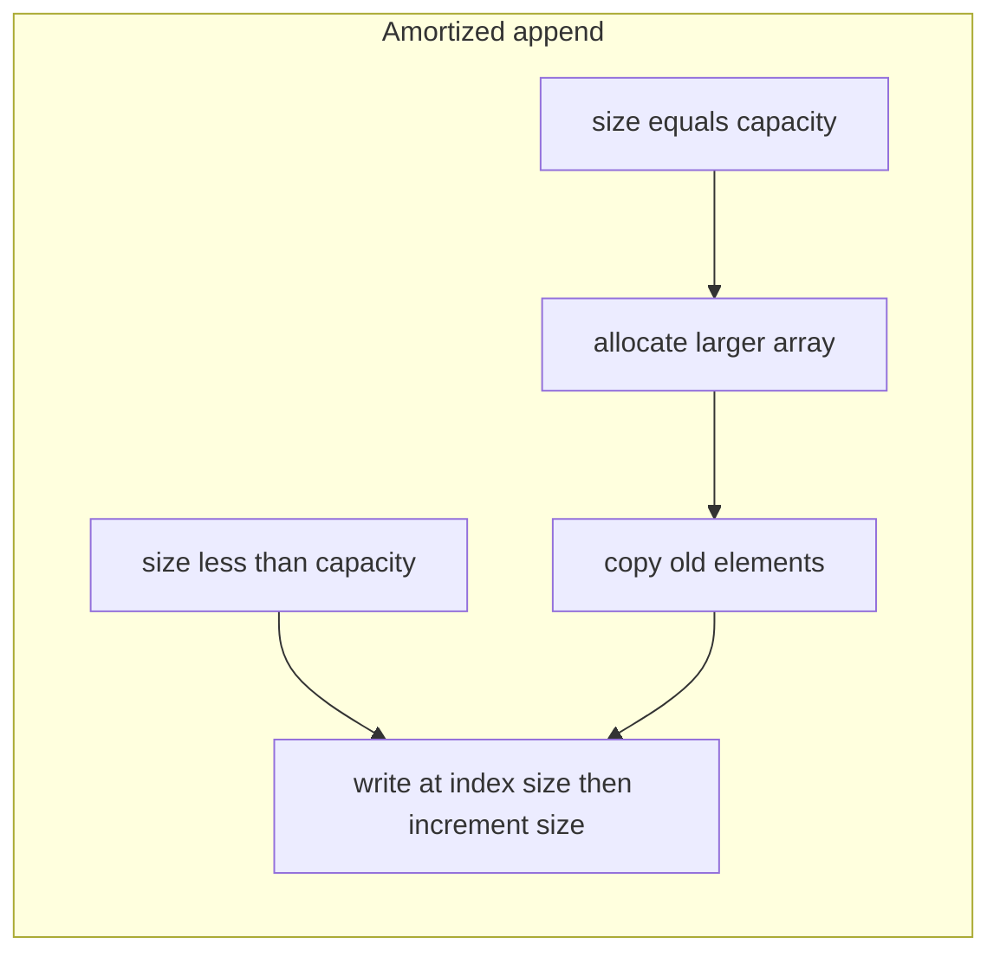
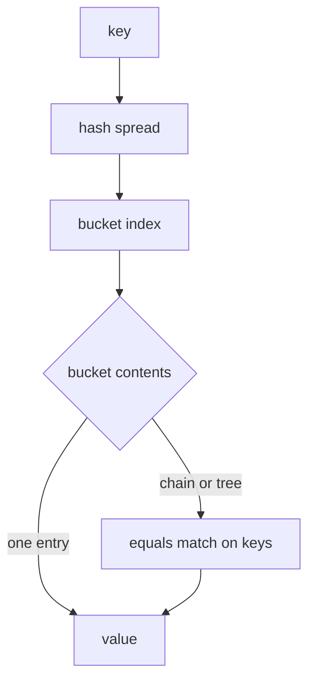

# Lecture 17 — ArrayList & HashMap internals: resizing, buckets, load factor, treeification

**Date:** Wed 28 Oct 2026 · **Book:** *Object-Oriented Programming and Java*, 2nd ed. — Ch.12 Generics and Collections Framework (pp.179–200; **Mon–Tue** covered **§12.1–12.6**; today is **implementation depth** on **`ArrayList`** / **`HashMap`** per `CURRICULUM.md` Week 4 — not a new book chapter)

**Time plan (1 h):** 10 min recap (Tue + **#1** wildcard part) · 20 min read this lecture + skim OpenJDK **`ArrayList.java`** / **`HashMap.java`** · 30 min hands-on (curriculum **#2** primary; **#3** if time remains — problem statements in `CURRICULUM.md` only).

**Goal for today:** see how **`ArrayList`** achieves **amortized O(1)** append via **backing-array growth**, and how **`HashMap`** maps keys to **bucket indices** with **hashing**, **load factor**, **resize/rehash**, and (in modern JDKs) **treeification** when a bucket grows long — so curriculum **#2** and OpenJDK source reading feel grounded, not magical.

> **Pacing note:** Week 4 in `CURRICULUM.md` schedules **Mon = ch.12 §12.1–12.3**, **Tue = wildcards/erasure**, **Wed = ArrayList & HashMap internals** (*this file*), **Thu = sorting/searching, `equals`/`hashCode`, extra collections practice**, **Fri = JPA entity + repository**, **Sat = JPA queries + ch.17 JDBC skim + ch.16 serialization skim + review**. Do not invent schedule changes inside this lecture.

---

## 1. Recap hook (Tue — use the first 10 minutes)

Before internals, from memory in `notes/`:

1. **Three bullets from Lecture 16:** e.g. **PECS** (producer **extends**, consumer **super**); one **type erasure** consequence; how **`List<? extends Number>`** differs from **`List<Number>`** at call sites.
2. **One self-check from Tue:** e.g. why **`ArrayList`**’s internal storage is an **`Object[]`** after erasure; which ch.12 interface fits **unique keys → values** (**`Map`**, not **`List`**).
3. **Skim **#1** sum method:** confirm it compiles and your **`notes/`** paragraph names the wildcard (or bound) you chose — Wed hands-on shifts to **#2**; you do not need a perfect **#1** to start **#2**, but finish **#1** before **`week4`** proof.

Tue gave **interface vocabulary** and **erasure**. Wed opens the two structures you will reimplement in miniature (**#2**) and read in OpenJDK source.

*(Book ch.13–15 — GUI, applets, servlets — remain **skipped**; see `CURRICULUM.md` [Book chapters skipped on purpose](#book-chapters-skipped-on-purpose).)*

---

## 2. Week 4 arc (where Wed sits)

| Day | Theme (curriculum) | Lecture file | Carry into Wed |
|---|---|---|---|
| **Mon 26** | generics ch.12 §12.1–12.3 | `2026-10-26-ch12-generics.md` | **`List<E>`**, **`Map<K,V>`** types |
| **Tue 27** | wildcards / erasure | `2026-10-27-ch12-wildcards-erasure.md` | **`Object[]`** inside lists; **`Map`** role |
| **Wed 28** | ArrayList & HashMap internals | *this file* | resize, buckets, **#2** minimal implementations |
| **Thu 29** | sorting, equals/hashCode, collections practice | *(Thu lecture when published)* | **`equals`/`hashCode` contract**, **#3–#4** |
| **Fri 30** | JPA entity + repository | *(Fri lecture when published)* | Week 4 **#5** start |
| **Sat 31** | JPA queries + JDBC/serialization skim + review | *(Sat lecture when published)* | proof **`week4`** |

**Book read this week:** Ch.12 **§12.1–12.6** was Mon–Tue. Wed does **not** assign new § numbers — deepen **`List`** / **`Map`** implementations from curriculum **Topics** and OpenJDK source.

**Modern thread:** JDK **21** **`HashMap`** treeifies long bucket chains; **`List.of` / `Map.of`** remain immutable alternatives (Week 4 **Topics**). **`HashSet`** shares **`HashMap`**’s bucket logic (Thu **`equals`/`hashCode`**).

---

## 3. ArrayList — dynamic array mental model

**`ArrayList<E>`** is a **resizable array** abstraction: **O(1)** indexed **`get`** / **`set`** (bounds-checked), **amortized O(1)** append at the end, **O(n)** insert/remove in the **middle** (elements shift).

| Field (conceptual) | Meaning |
|---|---|
| **`elementData`** (or similar) | Backing **array** holding references (erasure → **`Object[]`** in the JDK) |
| **`size`** | Number of elements **logically** in the list |
| **capacity** | Length of the backing array (**≥ size**); may be **larger** than **`size`** after growth |

**Why not grow by +1 each append?** Appending **n** times with +1 reallocation copies **1 + 2 + … + n = O(n²)** element moves total. **Geometric growth** (new capacity ≈ **old × factor**, commonly **~1.5×** in OpenJDK **`ArrayList`**) spreads copy cost so **n** appends stay **O(n)** total → **amortized O(1)** per **`add`**.

**Operations (typical JDK behaviour — your **#2** should match in `notes/`):**

| Operation | Time | Note |
|---|---|---|
| **`get(i)`**, **`set(i, e)`** | **O(1)** | Random access by index |
| **`add(e)`** (end) | **Amortized O(1)** | Occasional **O(n)** copy on resize |
| **`add(i, e)`** | **O(n)** | Shift tail right |
| **`remove(i)`** | **O(n)** | Shift tail left |
| **`contains(o)`** | **O(n)** | Linear scan — contrast **`HashSet`** in curriculum **#4** Thu |

**LinkedList contrast (curriculum **Topics** only):** doubly-linked nodes give **O(1)** insert/remove **at an iterator position**, but **O(n)** indexed **`get`** — choose structure by access pattern, not folklore.

**Tie to Tue erasure:** compiler checks **`list.add("x")`** on **`ArrayList<String>`**; runtime array holds **`Object`** references; **`get`** may use a cast the compiler inserted. Your minimal list in **#2** can use **`Object[]`** and document the same trade-off.

**Read in source (10 min in the lecture block):** [`ArrayList.java`](https://github.com/openjdk/jdk/blob/master/src/java.base/share/classes/java/util/ArrayList.java) — search for **grow**, **ensureCapacity**, **`DEFAULT_CAPACITY`**, and the **`add`** path. You are not memorizing line numbers; notice **when** copy happens vs **when** a slot is reused.

Official: [Oracle Tutorial — Lists](https://docs.oracle.com/javase/tutorial/collections/interfaces/list.html), [dev.java — Collections](https://dev.java/learn/collections/).

---

## 4. HashMap — hashing, buckets, and lookup

**`HashMap<K,V>`** stores **entries** in an array of **buckets** (bins). Each bucket holds **zero or more** entries whose keys **hash to the same bucket index** (after spread/mod).

**High-level lookup (`get(key)`):**

1. **`null` key** — JDK uses a dedicated path (bucket 0); know it exists; **#2** can defer **`null`** keys until your map works for non-null keys.
2. Compute **`hash(key)`** — spread key’s **`hashCode()`** so high bits participate (JDK mixes bits to reduce clustering when table length is a power of two).
3. **Index** = `(n - 1) & hash` (when **n** is power of two) or equivalent — maps into **`[0, n-1]`**.
4. Walk the **bucket**: compare **hash**, then **`equals`** on keys until match or exhaust chain.
5. Return value or **`null`** (or “missing” — distinguish from “mapped to **`null`**” using **`containsKey`** in real code).

**`put(key, value)`** finds the bucket (same index step), replaces value if key **equals** an existing entry, else inserts. If **size** crosses threshold, **resize** first (next section).

**Average case:** with a **good hash spread** and **load factor** control, **`get`/`put`** are **O(1)** average; **worst case** degrades if many keys collide in one bucket.

---

## 5. Load factor, resize, and rehash

| Idea | Typical JDK default | Meaning |
|---|---|---|
| **Load factor** | **0.75** | Resize when **`size > capacity × loadFactor`** (conceptually — see source for exact threshold fields) |
| **Capacity** | starts small (e.g. **16**), always **power of two** | Makes index masking cheap; **rehash** required on resize |
| **Resize** | **double** bucket array (approx.) | **Rehash every entry** into new indices — **O(n)** for that resize, but infrequent enough to keep **amortized O(1)** **`put`** |

**Rehash intuition:** when **`n`** doubles, **`index = hash & (n-1)`** changes bit width — entries that collided in the old table may **separate** in the new table. After resize, chains are usually **shorter**.

**Your **#2** map:** implement **`put`/`get`**, array of buckets, pick a **load factor**, and on threshold allocate a **larger bucket array** and **reinsert** all entries. In **`notes/`**, state **average** vs **worst-case** time for **`get`/`put`** and what happens on resize.

---

## 6. Collisions, treeification, and the key contract (preview for Thu)

**Collision:** two **unequal** keys land in the same bucket (same index). JDK stores multiple entries per bucket as:

| Bucket shape | When (modern **`HashMap`**) | Lookup cost in bucket |
|---|---|---|
| **Linked list** | Short chains | **O(k)** for chain length **k** |
| **Balanced tree** | Chain longer than **treeify threshold** (8) and table large enough | **O(log k)** |

**Treeification** (Java 8+): if a bucket’s linked list grows beyond the threshold, entries may convert to a **tree** keyed by **`Comparable`** or **`Comparator`** on keys — reduces worst-case **O(n)** bucket walks under **hash collision attacks** or poor **`hashCode`**. **Untreeify** when table shrinks. You do **not** implement trees in **#2**; know **why** they exist when you read **`HashMap.java`**.

**`equals` / `hashCode` contract (Thu depth; Wed preview):**

| Rule | Consequence if broken |
|---|---|
| If **`a.equals(b)`**, then **`a.hashCode() == b.hashCode()`** | “Equal” keys scatter to different buckets → **`get`** misses |
| **`hashCode`** stable while key is in map (don’t mutate fields used in **`equals`/`hashCode`**) | Lost entries after “logical” key change |
| **`equals`** consistent with **`hashCode`** for map keys | Duplicate keys or wrong replacements |

**`HashSet`** stores elements as **`HashMap`** keys with a dummy value — same contract. Curriculum **#3** (broken **`hashCode`**, then fix; **`record`** key compare) fits **Wed stretch** or **Thu** primary; Thu lecture will formalize the contract for sorting and **`HashMap`** together.

**Read in source:** [`HashMap.java`](https://github.com/openjdk/jdk/blob/master/src/java.base/share/classes/java/util/HashMap.java) — **`Node`**, **`resize`**, **`treeifyBin`**, **`hash`**. Baeldung: [A Guide to HashMap](https://www.baeldung.com/java-hashmap) (conceptual; cross-check with source).

---

## 7. Minimal implementations vs JDK (curriculum **#2** framing)

**#2** asks for **arrays only** — no **`java.util.ArrayList`** / **`HashMap`** inside your implementations. Goal is **parallel structure**, not feature parity:

| Feature | Minimal **#2** | Full JDK |
|---|---|---|
| List growth | Your factor (document in **`notes/`**) | ~1.5×, **`ensureCapacity`** API |
| Map buckets | Array of heads (list per bucket) | List + optional tree |
| **`remove`** | Required on list; optional on map today | Full **`remove`**, iterators, views |
| **`null` key/value** | Your choice; document | **`HashMap`** allows one **`null`** key |

After **#2** compiles, **diff mentally** one **`add`** and one **`put`** against OpenJDK — note **modCount**, **fail-fast iterators**, and **views** as “later” concerns.

---

## 8. Design ties to your stack

| Layer | Wed concepts show up as… |
|---|---|
| **#2 scratch → `exercises/week4/`** | Growable list + bucket map; complexity table in **`notes/week4.md`** |
| **#3 (optional Wed / Thu)** | Broken key **`hashCode`** → silent **`get`** failures; **`record`** keys |
| **#4 Thu** | **`Map`** for word frequency; **`ArrayList.contains`** vs **`HashSet.contains`** timing |
| **Week 3 todos **#5**** | **`Map<Long, Todo>`** or JPA **`Map`**-like lookups via repository — **O(1)** average **`findById`** with indexed PK vs linear scan |
| **JPA entities (Fri)** | **`equals`/`hashCode`** on entities is subtle (identity vs business key) — Thu preview helps you avoid naive “all fields” **`equals`** on mutable entities |

---

## 9. Free resources (Week 4 Wed — links only)

Full Week 4 list lives in **`CURRICULUM.md`**; use these today:

- OpenJDK: [`ArrayList.java`](https://github.com/openjdk/jdk/blob/master/src/java.base/share/classes/java/util/ArrayList.java), [`HashMap.java`](https://github.com/openjdk/jdk/blob/master/src/java.base/share/classes/java/util/HashMap.java)
- [Oracle Tutorial — Implementations](https://docs.oracle.com/javase/tutorial/collections/implementations/index.html) ( **`ArrayList`**, **`HashMap`** summaries)
- [Oracle Tutorial — Object as HashMap key](https://docs.oracle.com/javase/tutorial/collections/interfaces/map.html)
- [dev.java — Collections](https://dev.java/learn/collections/)
- Baeldung: [Guide to Java Collections](https://www.baeldung.com/java-collections), [A Guide to HashMap](https://www.baeldung.com/java-hashmap)

---

## 10. Glossary

**backing array** · **capacity vs size** · **amortized analysis** · **geometric growth** · **bucket / bin** · **hash spread** · **load factor** · **resize / rehash** · **collision** · **chain** · **treeification** · **`hashCode`/`equals` contract** (preview) · **`HashSet`**-as-**`HashMap`** keys · **fail-fast** (preview)

---

## 11. Common pitfalls (Wed)

1. **Confusing `size` and capacity** on **`ArrayList`** — **`size()`** is logical length; capacity is internal until you expose it in **#2**.
2. **Assuming `get` is O(1) on `LinkedList`** — indexed access is **O(n)**.
3. **Implementing map without rehash on resize** — lookups still “work” but degrade to one giant bucket.
4. **Using `% table.length` with non-power-of-two length** — JDK uses power-of-two and masking; stay consistent in **#2** **`notes/`**.
5. **Forgetting `equals` after hash match** — **`hashCode`** collisions require **`equals`** confirmation.
6. **Mutating a key object after `put`** — breaks map invariants (Thu ties to **`hashCode`** stability).
7. **Copy-pasting JDK into **#2**** — curriculum wants **your** minimal arrays + **your** complexity write-up.
8. **Book detour ch.13–15** — stay on collections + JPA path per **`CURRICULUM.md`**.

---

## 12. Self-check (answer in `notes/`, then skim OpenJDK source)

1. Why is **append-to-end** on a growable array **amortized O(1)** but **insert-at-index-0** **O(n)**?
2. When **`HashMap`** resizes, why must **every** entry be **rehashed**, not just copied to the same index?
3. What two checks does **`get`** perform on entries in a bucket (after computing the index)?
4. What problem does **treeification** address in a single bucket?
5. If **`a.equals(b)`** but **`a.hashCode() != b.hashCode()`**, what symptom might you see on **`map.get(b)`** after **`map.put(a, v)`**?
6. How does Tue’s **type erasure** show up in **`ArrayList`**’s internal array type?

*Stuck for more than 15 min? Write the exact error/question in `notes/` and ask for a review — hints and feedback, not solutions.*

---

## 13. Hands-on (Wed — curriculum prompts only; you write all code)

Week 4 proof set: **five prompts** in **`CURRICULUM.md` Week 4 (**#1–#5**). Problem statements live in the curriculum only — **no solution code** in this lecture.

**Wed 28 Oct (after this read + source skim):** primary focus is curriculum **#2**; **#3** if time remains.

### Curriculum **#2** (primary — problem statement only)

From **`CURRICULUM.md` Week 4 hands-on **#2**:** implement a **minimal growable array list** (**`add`**, **`get`**, **`remove`**, **`size`**) and a **minimal hash map** (**`put`**, **`get`**) using **only arrays**. Describe in **`notes/`** how **resizing** works and the **time complexity** of each operation.

| Part | Wed guidance |
|---|---|
| **Growable list** | Backing array, growth policy, **`size`**; document **amortized** append |
| **Minimal map** | Bucket array, **`hashCode`/`equals`** on keys, load factor + **rehash** |
| **OpenJDK skim** | One **`add`** path + one **`put`/`resize`** path — bullet compare in **`notes/`** |
| **#1** | Finish wildcard sum if incomplete — not Wed primary |
| **#3** | Optional stretch today; Thu **`equals`/`hashCode`** day if not started |

Work in scratch under e.g. **`exercises/2026-10-28-collections-internals/`** until you consolidate into **`exercises/week4/`** for the **`week4`** proof artifact (benchmark table for **#4** lands Thu per curriculum).

### Curriculum **#3** (optional Wed — problem statement only)

From **`CURRICULUM.md` Week 4 hands-on **#3**:** create a class used as a **`HashMap`** key with a deliberately broken **`hashCode`** (or missing **`equals`**); write a test showing the failure, then fix it. Use a **`record`** as the key and compare.

| Part | Wed guidance |
|---|---|
| **Broken key demo** | Small test, **`notes/`** explains *why* lookup failed |
| **`record` key** | Note default **`equals`/`hashCode`** on components |
| **Depth** | Thu lecture expands contract for sorting + **`HashSet`** |

Closing habit (2 min): one line in **`notes/`** — what clicked / what confused you about **resize** vs **rehash**.

---

## 14. Bridge to Thu (per `CURRICULUM.md` Week 4)

**Tomorrow:** **sorting and searching**, the full **`equals`/`hashCode` contract**, and extra collections practice — **`Comparable` vs `Comparator`**, **`Collections.sort`**, **`TreeMap`**, and curriculum **#3–#4** (frequency map, **`contains`** timing). Wed’s bucket walk (**hash** then **`equals`**) becomes the centre of **key correctness** on Thu.

**Later this week:** **Spring Data JPA** entity + repository (Fri), queries + **ch.17 JDBC** skim + **ch.16 serialization** skim (Sat). Do not start **ch.13–15**; the web path remains **Spring Boot / JPA** per **`CURRICULUM.md`**.
