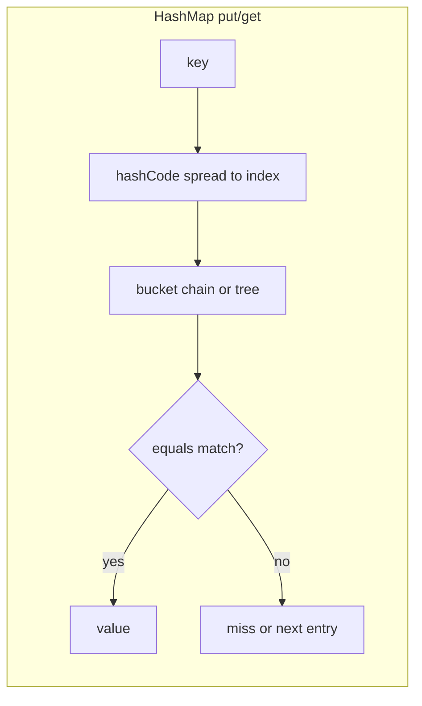

# Lecture 18 — Sorting & searching, `equals`/`hashCode` contract, collections & streams practice

**Date:** Thu 29 Oct 2026 · **Book:** *Object-Oriented Programming and Java*, 2nd ed. — Ch.12 Generics and Collections Framework (pp.179–200; **Mon–Tue** finished **§12.1–12.6**; **Wed** was **implementation depth** on **`ArrayList`** / **`HashMap`** — today is **ordering, key correctness, and applied collections practice** per `CURRICULUM.md` Week 4, not a new book chapter)

**Time plan (1 h):** 10 min recap (Wed + **#2** complexity notes) · 20 min read this lecture + skim **`Comparable`**, **`Comparator`**, **`Object.equals`/`hashCode`** in the [Java SE 21 API](https://docs.oracle.com/en/java/javase/21/docs/api/) · 30 min hands-on (curriculum **#3** primary; **#4** if time remains — problem statements in `CURRICULUM.md` only).

**Goal for today:** formalize the **`equals`/`hashCode` contract** so **`HashMap`**, **`HashSet`**, and **`TreeMap`** behave predictably; distinguish **`Comparable`** (natural order) from **`Comparator`** (external order); tie **streams** and **maps** to real tasks (frequency counts, membership timing) — so **#3** and **#4** feel connected to Wed’s bucket walk (**hash** then **`equals`**) and Tue’s framework vocabulary.

> **Pacing note:** Week 4 in `CURRICULUM.md` schedules **Mon = ch.12 §12.1–12.3**, **Tue = wildcards/erasure**, **Wed = ArrayList & HashMap internals**, **Thu = sorting/searching, `equals`/`hashCode`, extra streams/collections practice** (*this file*), **Fri = JPA entity + repository**, **Sat = JPA queries + ch.17 JDBC skim + ch.16 serialization skim + review**. Do not invent schedule changes inside this lecture.

---

## 1. Recap hook (Wed — use the first 10 minutes)

Before ordering and key contracts, from memory in `notes/`:

1. **Three bullets from Lecture 17:** e.g. **amortized O(1)** **`ArrayList.add`** at end vs **O(n)** middle insert; **load factor** and **rehash** on **`HashMap` resize**; why **`get`** in a bucket checks **hash** then **`equals`**.
2. **One self-check from Wed:** e.g. symptom when **`a.equals(b)`** but **`a.hashCode() != b.hashCode()`** after **`put(a, v)`**; difference between **`size`** and **capacity** on a growable list.
3. **Skim **#2** scratch:** confirm your minimal map **rehashes** on resize and your **`notes/`** table names **average** vs **worst-case** **`get`/`put`** — Thu **#3** assumes you have seen **why** keys matter inside buckets.

Wed opened **internals**. Thu makes **key equality** and **sort order** explicit — the same ideas **`TreeMap`** and **`Collections.sort`** rely on, and the same contract **`HashSet`** shares with **`HashMap`**.

*(Book ch.13–15 — GUI, applets, servlets — remain **skipped**; see `CURRICULUM.md` [Book chapters skipped on purpose](#book-chapters-skipped-on-purpose).)*

---

## 2. Week 4 arc (where Thu sits)

| Day | Theme (curriculum) | Lecture file | Carry into Thu |
|---|---|---|---|
| **Mon 26** | generics ch.12 §12.1–12.3 | `2026-10-26-ch12-generics.md` | typed **`Map<K,V>`** |
| **Tue 27** | wildcards / erasure | `2026-10-27-ch12-wildcards-erasure.md` | **`List`**, **`Map`**, streams preview |
| **Wed 28** | ArrayList & HashMap internals | `2026-10-28-arraylist-hashmap-internals.md` | buckets, **`hashCode`/`equals`** preview |
| **Thu 29** | sorting, equals/hashCode, collections practice | *this file* | **#3–#4**, **`Comparable` vs `Comparator`** |
| **Fri 30** | JPA entity + repository | *(Fri lecture when published)* | Week 4 **#5** start |
| **Sat 31** | JPA queries + JDBC/serialization skim + review | *(Sat lecture when published)* | proof **`week4`** |

**Book read this week:** Ch.12 **§12.1–12.6** was Mon–Tue. Thu does **not** assign new § numbers — apply ch.12 **interface** ideas (**`Map`**, **`Set`**, **`SortedMap`**) with modern JDK APIs and Week 2 **stream** habits.

**Modern thread:** **`record`** default **`equals`/`hashCode`** (Week 1); **`List.of` / `Map.of`** immutability (Week 4 **Topics**); **`Stream`** **`collect`**, **`groupingBy`**, **`counting`** for frequency-style tasks in **#4**.

---

## 3. Sorting — natural order vs external order

Collections and arrays can be **ordered** in two main ways:

| Mechanism | Where it lives | Typical use |
|---|---|---|
| **`Comparable<T>`** | **On the element type** — **`compareTo(T other)`** defines **natural order** | **`String`**, **`Integer`**, **`LocalDate`**; keys in **`TreeMap`** when no **`Comparator`** supplied |
| **`Comparator<T>`** | **Separate object** (or lambda) — **`compare(a, b)`** defines **any** order | Sort by **price** then **name**; **`Comparator.comparing`**, **`thenComparing`**, **`reversed()`** |

**Natural order rules ( **`Comparable`** ):**

- **Antisymmetric:** if **`a.compareTo(b) == 0`**, then **`b.compareTo(a) == 0`**.
- **Consistent with equals (strongly recommended):** if **`a.compareTo(b) == 0`**, then **`a.equals(b)`** should be **`true`** for types used as **`TreeSet`/`TreeMap`** keys — otherwise “equal” in sort but unequal in set/map causes subtle bugs.

**API entry points (know names; use docs for signatures):**

| Task | JDK approach |
|---|---|
| Sort a **`List`** in place | **`Collections.sort(list)`** (natural) or **`list.sort(comparator)`** |
| Immutable sorted copy | **`stream().sorted()`** or **`Stream.sorted(comparator)`** |
| Sorted map | **`TreeMap`** (natural or **`TreeMap(comparator)`**) |
| Binary search on sorted structure | **`Collections.binarySearch`** — requires list **already sorted** with the **same** ordering |

**Link to Wed treeification:** when a **`HashMap`** bucket **treeifies**, keys in that bucket are ordered by **`Comparable`** or an explicit **`Comparator`** — another place **consistent ordering** matters.

Official: [Oracle Tutorial — Object Ordering](https://docs.oracle.com/javase/tutorial/collections/interfaces/sort.html), [Aggregate Operations — reduction and mutable reduction](https://docs.oracle.com/javase/tutorial/collections/streams/reduction.html).

---

## 4. Searching — linear vs hash vs tree

| Structure | **`contains(key)`** / lookup | Ordering |
|---|---|---|
| **`ArrayList`** | **O(n)** linear scan (Wed) | insertion order only |
| **`HashSet`** / **`HashMap`** | **O(1)** average (good **`hashCode`**, load factor) | none |
| **`TreeSet`** / **`TreeMap`** | **O(log n)** | sorted by **`Comparable`** or **`Comparator`** |

Curriculum **#4** asks you to **measure** **`ArrayList.contains`** vs **`HashSet.contains`** at large **n** — you are validating Wed’s complexity table with a stopwatch, not memorizing constants.

**Streams tie-in (Week 2 refresh):** searching/filtering often appears as **`stream().filter(...).findFirst()`** or **`anyMatch`** — still **O(n)** unless backed by an index or hash structure. For **“top 10 by frequency”**, a **`Map`** (or **`groupingBy` + **`counting`**) is the right aggregate, not repeated linear scans over the whole word list.

---

## 5. The `equals` / `hashCode` contract (formal)

Every **`Object`** inherits **`equals`** and **`hashCode`**. **`HashMap`**, **`HashSet`**, **`Hashtable`**, and **`IdentityHashMap`** (different rules) are the structures where breaking the contract hurts most.

**General contract ( **`Object`** javadoc — paraphrase for study):**

| Rule | Meaning |
|---|---|
| **Reflexive** | **`x.equals(x)`** is **`true`** |
| **Symmetric** | **`x.equals(y)`** iff **`y.equals(x)`** |
| **Transitive** | if **`x.equals(y)`** and **`y.equals(z)`**, then **`x.equals(z)`** |
| **Consistent** | repeated calls with unchanged state return the same result |
| **`null`** | **`x.equals(null)`** is **`false`** |

**Hash code contract (critical for hash tables):**

| Rule | Meaning |
|---|---|
| **Consistency** | if **`equals`** unchanged, **`hashCode`** unchanged |
| **Equal objects → equal hash codes** | if **`x.equals(y)`**, then **`x.hashCode() == y.hashCode()`** |
| **Unequal objects** | may share hash codes (collision) — **`equals`** disambiguates in the bucket |

**What breaks in practice:**

| Mistake | Symptom |
|---|---|
| Override **`equals`**, not **`hashCode`** (or vice versa) | **`Set`** duplicates; **`get`** returns **`null`** for “same” key |
| **`hashCode`** uses different fields than **`equals`** | Equal logical keys scatter to different buckets |
| **Mutable key** — field in **`equals`/`hashCode`** changes after **`put`** | “Lost” entry; cannot **`remove`** reliably |
| **Subclass breaks symmetry** with **`equals`** | **`Set`**/**`Map`** behaviour depends on which type you used at **`put`** |

**`record` keys (curriculum **#3** compare):** the compiler generates **`equals`/`hashCode`** from **all components** — good for **immutable** composite keys (e.g. **`record Point(int x, int y)`**). Contrast with a **mutable class** where you must maintain the contract by hand.

**Do not use `==` for logical equality** of object contents — **`==`** is **identity** (same reference). **`HashMap`** uses **`equals`** after hash match.

Baeldung (conceptual): [Java equals and hashCode Contracts](https://www.baeldung.com/java-equals-and-hashcode); Oracle: [The Map Interface](https://docs.oracle.com/javase/tutorial/collections/interfaces/map.html).

---

## 6. `equals` on classes vs records vs JPA (preview for Fri)

| Type | Equality story | Thu takeaway |
|---|---|---|
| **Mutable class** | You define **`equals`/`hashCode`** (or inherit **`Object`** identity) | **#3** — broken vs fixed key |
| **`record`** | Value equality on components; immutable | **#3** — compare behaviour as **`HashMap`** key |
| **JPA entity (Fri)** | **Database identity** vs **business key** — naive “all fields” **`equals`** on mutable entities is dangerous | Use **stable business key** or **id-only** equality in **`equals`/`hashCode`** when required; Fri lecture goes deeper |

Thu prepares **#3**; Fri **#5** persistence does **not** replace today’s contract — it **adds** entity identity rules on top.

---

## 7. Streams + collections — frequency and aggregation (**#4** framing)

**Word frequency → top 10** is a **map-reduce** shape:

1. **Count:** walk tokens; for each word, update a **`Map<String, Integer>`** (or **`Map.merge`**, or **`Collectors.groupingBy` + `counting`**).
2. **Rank:** sort **entries** by count (**`Comparator.comparing(Map.Entry::getValue).reversed()`**) or use a **partial selection** structure if you optimize — curriculum asks for **top 10**, not full sort theory.
3. **Document:** record algorithm and any tie-breaking rule you chose in **`notes/`**.

**Immutability (Week 4 Topics):** **`Map.of`**, **`List.of`** — fine for **small fixed** data; building frequency tables needs **mutable** maps unless you stream into a collector. Know when **`copyOf`** helps freeze a result for safe sharing.

**Week 2 link:** you already used **`filter` / `map` / `collect`** — today’s **`groupingBy`** is the same pipeline mindset with **`Map`** as output.

Official: [Stream Collectors](https://docs.oracle.com/javase/tutorial/collections/streams/collecting.html), [dev.java — Collections](https://dev.java/learn/collections/).

---

## 8. Other Week 4 collection types (skim — context only)

Curriculum **Topics** also name **`LinkedList`**, **`TreeMap`**, **`ArrayDeque`**. Thu touchpoints:

| Type | One-line when |
|---|---|
| **`LinkedList`** | Frequent insert/remove at **ends** or with **iterators**; poor indexed **`get`** |
| **`TreeMap`** | Sorted keys, **range views**, **`subMap`** — needs **`Comparable`** keys or **`Comparator`** |
| **`ArrayDeque`** | Stack/queue on array, no **`null`** elements — prefer over legacy **`Stack`** |

You do **not** need a deep dive today; **#4** focuses on **`ArrayList` vs `HashSet`** membership.

---

## 9. Design ties to your stack

| Layer | Thu concepts show up as… |
|---|---|
| **#3 → `exercises/week4/`** | Demonstrate broken then fixed key; **`record`** comparison in **`notes/week4.md`** |
| **#4** | Frequency **`Map`** + benchmark table row for **`contains`** |
| **Week 3 todo API** | In-memory **`Map<Long, Todo>`** assumed correct **`equals`** on **`Long`** keys (boxed identity OK); JPA **Fri** uses **PK** |
| **Spring Data JPA (Fri)** | **`findById`**, derived queries — DB indexes vs Java **`HashMap`**; entity **`equals`/`hashCode`** caution |
| **Sets in APIs** | Deduplication (**`HashSet`**), unique tags — contract errors show up as duplicate rows or missed lookups |

---

## 10. Free resources (Week 4 Thu — links only)

Full Week 4 list lives in **`CURRICULUM.md`**; use these today:

- [Oracle Tutorial — Object Ordering](https://docs.oracle.com/javase/tutorial/collections/interfaces/sort.html)
- [Oracle Tutorial — Set / Map implementations](https://docs.oracle.com/javase/tutorial/collections/interfaces/set.html)
- [Oracle Tutorial — Stream aggregation](https://docs.oracle.com/javase/tutorial/collections/streams/reduction.html)
- [Java SE 21 — `Object#equals`, `Object#hashCode`](https://docs.oracle.com/en/java/javase/21/docs/api/java.base/java/lang/Object.html)
- [dev.java — Generics & Collections](https://dev.java/learn/collections/)
- Baeldung: [Guide to Java Collections](https://www.baeldung.com/java-collections), [A Guide to HashMap](https://www.baeldung.com/java-hashmap)

---

## 11. Glossary

**natural order** · **`Comparable`/`compareTo`** · **`Comparator`** · **consistent with equals** · **`equals`/`hashCode` contract** · **collision** · **mutable key hazard** · **`record` value semantics** · **linear vs hash lookup** · **`groupingBy`/`counting`** · **`TreeMap`** · **binary search precondition (sorted)**

---

## 12. Common pitfalls (Thu)

1. **Sorting then binary searching with a different order** — comparator must match.
2. **`TreeSet` with incomplete `compareTo`** — all “equal” compareTo-zero elements collapse to **one** set member even if **`equals`** is false.
3. **Using mutable lists as map keys** — never.
4. **`hashCode()` constant** (e.g. always **42**) — every key in one bucket; works “correctly” but **O(n)** per op — good for **#3** demo, bad for production.
5. **Assuming `stream().distinct()` fixes broken `equals`** — **`distinct()`** uses **`equals`**; broken contract → wrong dedupe.
6. **Confusing **`==`** on `String`** with **`equals`** — use **`equals`** for content (and remember **intern** only when you understand the pool).
7. **Forgetting case/folding in word frequency** — decide **`toLowerCase` locale** and document in **`notes/`**.
8. **Book detour ch.13–15** — stay on collections + JPA path per **`CURRICULUM.md`**.

---

## 13. Self-check (answer in `notes/`, then start **#3**)

1. When should you use **`Comparator`** instead of **`Comparable`**?
2. State the **`hashCode`** rule that **`equals`** imposes.
3. Why can **`HashMap`** still find a value after **hash collisions**?
4. Why is **`ArrayList.contains`** **O(n)** but **`HashSet.contains`** **O(1)** average?
5. If **`compareTo`** returns **0** but **`equals`** is **false**, what can go wrong in a **`TreeSet`**?
6. Name two safe ways to use **`record`** types as **`HashMap`** keys.
7. For **#4**, why is a **`Map`** better than scanning the full word list for **each** distinct word?

*Stuck for more than 15 min? Write the exact error/question in `notes/` and ask for a review — hints and feedback, not solutions.*

---

## 14. Hands-on (Thu — curriculum prompts only; you write all code)

Week 4 proof set: **five prompts** in **`CURRICULUM.md` Week 4 (**#1–#5**). Problem statements live in the curriculum only — **no solution code** in this lecture.

**Thu 29 Oct (after this read):** primary focus is curriculum **#3**; **#4** when **#3** tests pass and you have documented the broken vs fixed behaviour.

### Curriculum **#3** (primary — problem statement only)

From **`CURRICULUM.md` Week 4 hands-on **#3**:** create a class used as a **`HashMap`** key with a deliberately broken **`hashCode`** (or missing **`equals`**); write a test showing the failure, then fix it. Use a **`record`** as the key and compare.

| Part | Thu guidance |
|---|---|
| **Broken key demo** | Small program or test; **`notes/`** explains *symptom* (e.g. duplicate **`Set`** entries, **`get`** miss) and *cause* |
| **Fix** | Align **`equals`** and **`hashCode`** fields; verify **`get`/`containsKey`** after fix |
| **`record` key** | Same logical key as **`record`** vs your class — compare lines of code and mutability |
| **#1–#2** | Finish before **`week4`** proof if still open — not Thu primary |

Work in scratch under e.g. **`exercises/2026-10-29-equals-hashcode/`** until you consolidate into **`exercises/week4/`**.

### Curriculum **#4** (secondary — problem statement only)

From **`CURRICULUM.md` Week 4 hands-on **#4**:** given a large list of words, find the **10 most frequent** using a **`Map`**, and then compare timing for **`ArrayList.contains`** vs **`HashSet.contains`** on **1,000,000** elements.

| Part | Thu guidance |
|---|---|
| **Frequency map** | Your tokenization and tie-break rules documented in **`notes/`** |
| **Top 10** | Any correct selection method; justify briefly |
| **Benchmark** | Warm up JVM if you use **`System.nanoTime()`**; record setup (how list/set built) in **`notes/week4.md`** table |
| **Wed link** | **`ArrayList.contains`** = linear; **`HashSet`** = hash + **`equals`** |

Closing habit (2 min): one line in **`notes/`** — what clicked / what confused you about **`equals`** vs **`hashCode`**.

---

## 15. Bridge to Fri (per `CURRICULUM.md` Week 4)

**Tomorrow:** **Spring Data JPA** — **entity**, **repository**, **H2** (dev), first persisted todo from Week 3’s API shape (**curriculum **#5** start**). You will map **rows** to **objects** instead of only **`HashMap`** entries; **`@Id`** and **generated keys** replace “make a good **`hashCode`**” for database identity, but **value objects** and **composite keys** still need today’s contract when they appear in collections or caches.

**Sat:** derived queries, paging, **ch.17 JDBC skim** (what JPA abstracts), **ch.16 serialization skim** — then **`week4`** proof artifact (**#1–#5**, benchmark table, persisted todo).

Do not start **ch.13–15**; the web path remains **Spring Boot / JPA** per **`CURRICULUM.md`**.
